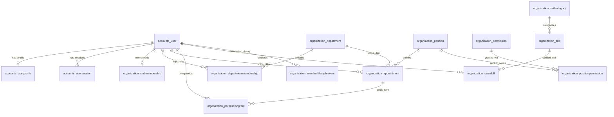
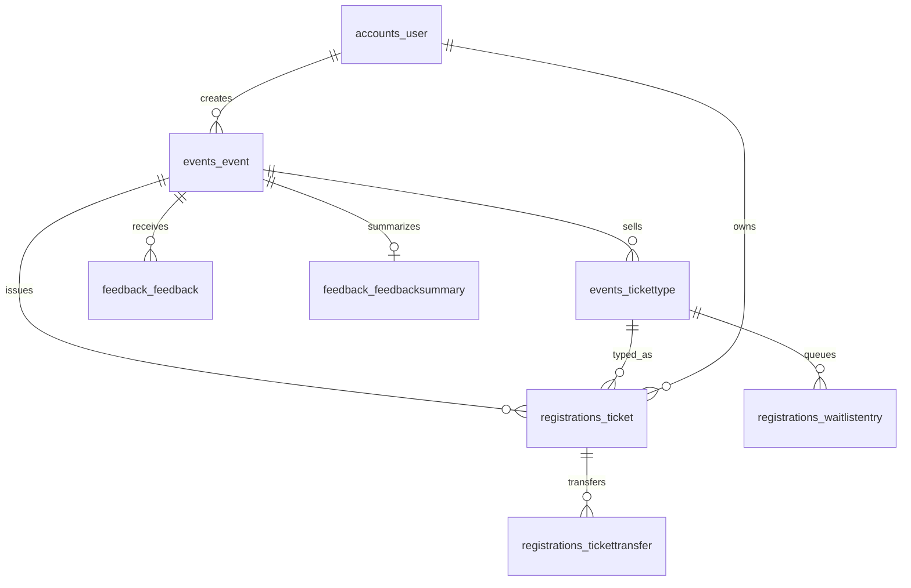
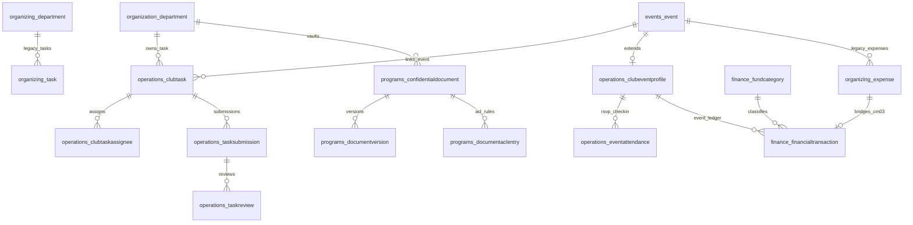
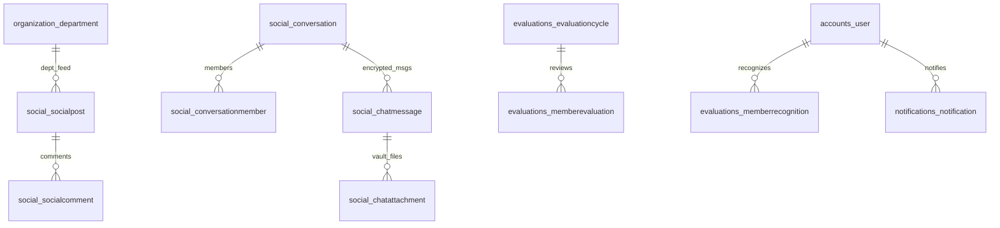

# ERD — SƠ ĐỒ QUAN HỆ THỰC THỂ KMG PLATFORM

Tài liệu tổng hợp sơ đồ thực thể (ERD) trích xuất trực tiếp từ `99` model thực tế của hệ thống KMG (`MySQL 8.4`, `InnoDB`).

## 1. Lõi Danh tính, Tổ chức & Phân quyền (`accounts`, `organization`)

## 2. Sự kiện, Đặt vé, Check-in & Đánh giá (`events`, `registrations`, `feedback`)

## 3. Vận hành, Công việc, Tài chính & Tài liệu (`operations`, `organizing`, `finance`, `programs`)

## 4. Mạng xã hội nội bộ, Nhắn tin Mã hóa, Đánh giá & AI (`social`, `evaluations`, `aiassist`)

